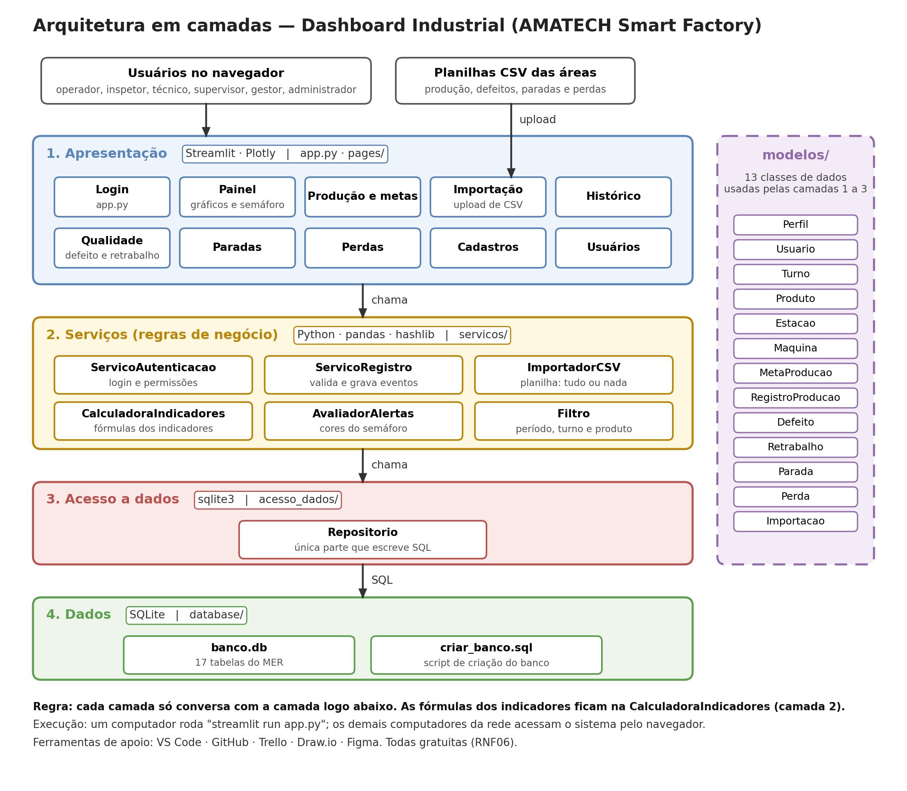

# Dashboard Industrial — AMATECH Smart Factory

Painel único para acompanhar a produção da AMATECH Electronics (fábrica fictícia de notebooks no Polo Industrial de Manaus), com indicadores calculados automaticamente e alertas em semáforo.

Projeto 3 do **Projeto Integrador** da disciplina Ambiente Fabril I · Engenharia da Computação · Fundação Matias Machline · 2026.

## O problema

**Problema 8 — Indicadores dispersos.** Os dados de produção, qualidade, manutenção e perdas ficam em arquivos separados, registrados em papel ou planilha e consolidados manualmente ao fim do turno. Um desvio do início do turno pode levar horas para ser percebido.

## A solução

- Um **banco de dados único**, alimentado por formulários (no momento do evento) e por **planilhas CSV**.
- **Seis indicadores** calculados na hora da consulta: atendimento da meta, produtividade, índice de defeitos, índice de retrabalho, tempo de parada e perdas.
- Um **painel com semáforo** (verde, amarelo e vermelho) e aviso de paradas em andamento.
- **Perfis de acesso**: operador, inspetor, manutenção, supervisor, gestor/diretoria e administrador.

## Andamento

| Etapa | Situação |
| --- | --- |
| OA1 — Diagnóstico e requisitos | Concluída |
| OA2 — Modelagem da solução | Concluída (ver `docs/`) |
| OA3 — Desenvolvimento do MVP | Em desenvolvimento: 5 sprints de 01/10 a 04/11/2026 |

| Sprint | Período | Foco |
| --- | --- | --- |
| S1 | 01/10 a 07/10 | Base do projeto: estrutura, banco, classes de dados, Repositorio |
| S2 | 08/10 a 14/10 | Acesso e cadastros: login, menu por perfil, usuários, cadastros |
| S3 | 15/10 a 21/10 | Registros: produção e metas, qualidade, paradas, perdas |
| S4 | 22/10 a 28/10 | Painel, histórico e importação de CSV |
| S5 | 29/10 a 04/11 | Testes, correções, README, manual de instalação e vídeo |

## Arquitetura

Quatro camadas; cada camada só conversa com a camada logo abaixo.

| Camada | Pasta | Tecnologia |
| --- | --- | --- |
| 1. Apresentação | `app.py`, `pages/` | Streamlit, Plotly |
| 2. Serviços (regras e fórmulas) | `servicos/` | Python, pandas, hashlib |
| 3. Acesso a dados | `acesso_dados/` | sqlite3 |
| 4. Dados | `database/` | SQLite |
| Classes de dados (usadas pelas camadas 1 a 3) | `modelos/` | Python |



## Estrutura do repositório

```
amatech-dashboard-industrial/
├── app.py              ← (a criar) tela de login, entrada do sistema
├── pages/              ← telas do Streamlit
├── servicos/           ← regras de negócio e cálculo dos indicadores
├── modelos/            ← as 13 classes de dados
├── acesso_dados/       ← repositorio.py, única parte que escreve SQL
├── database/           ← script SQL do banco (o arquivo .db não vai para o Git)
├── testes/             ← testes das fórmulas e das regras
├── docs/               ← relatório da OA2, diagramas, wireframes e planejamento
├── requirements.txt
└── README.md
```

## Como executar (depois da S1)

```bash
# 1. Criar e ativar um ambiente virtual
python -m venv .venv
# Windows: .venv\Scripts\activate    |    Linux/Mac: source .venv/bin/activate

# 2. Instalar as bibliotecas
pip install -r requirements.txt

# 3. Criar o banco a partir do script (com dados de teste)
python -c "import sqlite3; sqlite3.connect('database/banco.db').executescript(open('database/banco_dashboard_industrial.sql', encoding='utf-8').read())"

# 4. Abrir o sistema no navegador (quando app.py existir)
streamlit run app.py
```

Usuário de teste criado pelo script: `admin` / `admin123` (somente para testes; trocar antes de qualquer uso real).

## Documentação

| Documento | Arquivo |
| --- | --- |
| Relatório da OA2 (modelagem completa) | [`docs/relatorio_oa2.md`](docs/relatorio_oa2.md) |
| Contexto do projeto para integração com outros sistemas | [`docs/contexto_projeto_dashboard_industrial.md`](docs/contexto_projeto_dashboard_industrial.md) |
| MER, casos de uso, classes, fluxo e arquitetura (.png e .drawio) | [`docs/diagramas/`](docs/diagramas/) |
| Wireframes das 10 telas | [`docs/wireframes/`](docs/wireframes/) |
| Planejamento da OA3 | [`docs/planejamento/`](docs/planejamento/) |

Os arquivos `.drawio` abrem em [diagrams.net](https://app.diagrams.net) (Arquivo → Abrir de → Dispositivo).

## Equipe

| Integrante | Papel |
| --- | --- |
| Letícia | Líder; coordenação, revisão do código e autenticação |
| Vinicius | Analista de processos; regras de negócio e importação de CSV |
| Mateus | Desenvolvedor; banco de dados e cálculo dos indicadores |
| Radier | Desenvolvedor de interface; as 10 telas em Streamlit |
| Jose Orlando | Testes e documentação |
